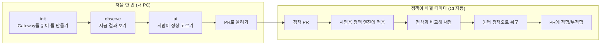

# gateprobe

AI 에이전트의 도구 호출을 막는 문지기, 곧 [Amazon Bedrock AgentCore Gateway](https://aws.amazon.com/bedrock/agentcore/)의 정책이 제대로 일하는지 점검하는 도구다.

정해 둔 도구 호출을 모델 없이 Gateway에 보내고, 호출마다 허용됐는지 막혔는지를 사람이 미리 정해 둔 **정상**(기대 결과)과 비교한다. 결과는 HTML 점검 결과서와 종료 코드로 나온다. 정책을 고치는 PR마다 CI에서 돌리면, 막아야 할 호출이 열리는 변경을 병합 전에 잡을 수 있다.

> 2026학년도 2학기 캡스톤 디자인 프로젝트(Gateway 정책 사례 연구, 설정 지침, 점검 도구)의 점검 도구 부분이다. 0.4.0까지의 이름은 `gwcheck`였고, 옛 명령 `gwcheck`도 그대로 동작한다.

## 무엇을 하나

- 시나리오 파일에 적힌 호출 순서를 그대로 보낸다. 예: 민감 문서 읽기 → 수치를 덧붙인 공지
- 응답을 다섯 가지로 나눈다: 허용, 정책 차단, 권한(IAM) 차단, 도구 오류, 판정 불가
- 사람이 정한 정상과 같으면 일치, 다르면 불일치. 하나라도 불일치면 종합 판정이 **부적합**이고 종료 코드 1
- 응답을 나누지 못하거나 사전 준비가 실패하면 **점검 미완료**(종료 코드 2). 통과로 보고하지 않는다

## 흐름



## 왜 정상을 사람이 정하나

정책 파일을 읽고 정상을 자동으로 정하면, 잘못 고친 정책도 그대로 정상이 된다. 그래서 정상은 업무 규칙을 아는 사람이 정하고, 도구는 그 정상대로 막히는지를 매번 같은 방식으로 확인한다. 같은 방향의 근거:

- 자동으로 만든 테스트 정답은 프로그램의 실제 동작을 따라가는 경향이 있어 버그를 찾기 어렵다 ([Konstantinou 외, arXiv:2410.21136](https://arxiv.org/abs/2410.21136))
- 업무 로직 결함은 범용 스캐너로 찾기 어렵고, 업무 규칙을 아는 사람이 시험해야 한다 ([OWASP WSTG 4.10](https://owasp.org/www-project-web-security-testing-guide/v42/4-Web_Application_Security_Testing/10-Business_Logic_Testing/00-Introduction_to_Business_Logic))
- LLM은 접근 정책을 그럴듯하게 설명하지만, 정책이 정확히 무엇을 허용하는지는 믿을 만하게 판단하지 못한다 ([Vatsa 외, ISSRE 2026, arXiv:2510.20692](https://arxiv.org/abs/2510.20692))
- 테스트 정답을 가려내는 일은 자동화의 병목이고, 마지막 정답의 출처는 업무 지식을 가진 사람이다 ([Barr 외, IEEE TSE 2015](https://doi.org/10.1109/TSE.2014.2372785))

화면(`gateprobe ui`)은 정상을 대신 정하지 않는다. 정상 칸은 비워 두고, observe가 한 번 보내 본 지금 결과는 참고로만 보여 준다.

## 빠른 시작

Python 3.10 이상.

```bash
pip install .                      # 이 저장소 폴더에서 (AWS 접속용 boto3도 설치)
gateprobe --help
```

| 순서 | 명령 | 하는 일 |
| --- | --- | --- |
| 1 | `gateprobe init --gateway <이름 또는 ID> --region <지역>` | Gateway를 읽어 대상 파일과 시나리오 틀을 만든다 |
| 2 | `gateprobe doctor --target checks/target.json` | 자격 증명, 접속, MCP 버전, 정책 엔진 모드를 진단한다 |
| 3 | (파일 편집) | 시나리오의 인자를 채운다 |
| 4 | `gateprobe observe --spec checks/scenarios.json --target checks/target.json --execute` | 정상이 TODO인 단계를 한 번 보내 지금 결과를 적은 초안을 만든다 |
| 5 | `gateprobe ui --spec checks/scenarios.json --target checks/target.json` | 브라우저 화면에서 단계마다 정상(허용 / 차단 / 기록만)을 고르고 저장한다 |
| 6 | `gateprobe run --spec checks/scenarios.json --target checks/target.json --execute --html report.html` | 점검하고 결과서를 만든다 |

자세한 설명서(설치 문제, JWT 인증, 결과서 읽는 법, 용어)는 [gateprobe/README.md](gateprobe/README.md)에 있다.

**주의**: 허용된 호출은 실제로 실행된다(발송, 삭제, 송금 등). 운영 Gateway가 아니라 시험용 Gateway와 시험용 데이터에 쓴다.

## CI에 붙이기

[gateprobe/examples/ci/github-actions.yml](gateprobe/examples/ci/github-actions.yml)이 GitHub Actions 예시다. 우리 시연 저장소에서는 정책 PR마다 다음을 한다.

1. PR의 정책을 시험용 복제 정책 엔진에 적용
2. 핵심 시나리오와 홀드아웃 시나리오로 채점
3. 성공이든 실패든 main의 정책으로 복구하고 기준 점검을 다시 통과하는지 확인
4. 실행 요약과 HTML/JUnit 결과서를 남김 (계정 ID는 가림)

CI 역할은 OIDC로 받고, 권한은 시험용 복제본으로만 좁힌다.

## 확인한 범위와 한계

- 시험한 Gateway: 우리가 만든 스택 2개와 AWS 공개 예제 2개. 모든 Gateway에서 동작한다고 말하지 않는다
- 인증: IAM(SigV4), JWT 토큰, OAuth client_credentials(토큰 자동 발급). MCP 2026-07-28, 2025-11-25 (2025-11-25만 받으면서 세션을 요구하는 Gateway는 아직 안 됨)
- 시나리오에 적은 호출만 본다. 정책 전체가 안전하다는 증명이 아니다
- 에이전트(모델)가 실제로 그런 호출을 할지는 보지 않는다. 호출이 왔을 때 Gateway가 막는지를 본다
- 배포된 Gateway가 있어야 한다. Terraform 파일을 읽는 정적 검사가 아니다
- 시간 조건은 시나리오에 넣은 대기(예: 90초)까지만 본다

## 시험

```bash
python -m gateprobe.test_gateprobe   # AWS 없이 가짜 Gateway로
python -m gateprobe.test_ui          # 정상 확인 화면
```

## 라이선스

MIT. [LICENSE](LICENSE)
