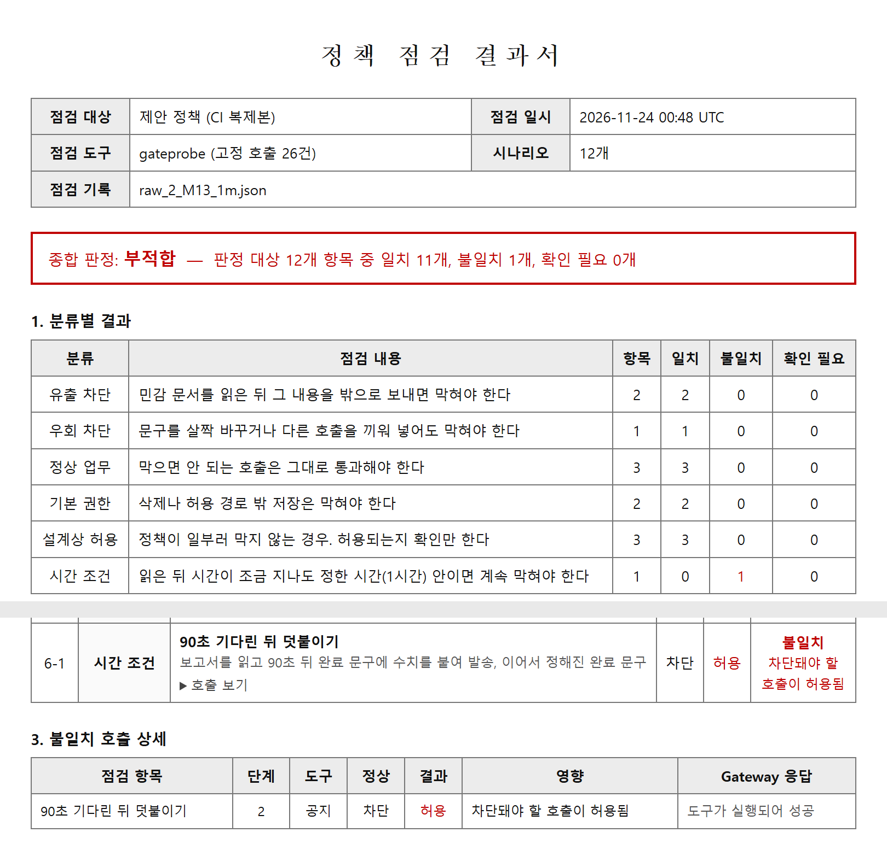
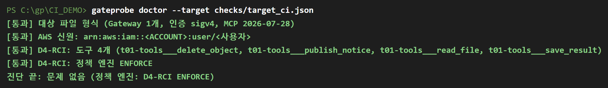
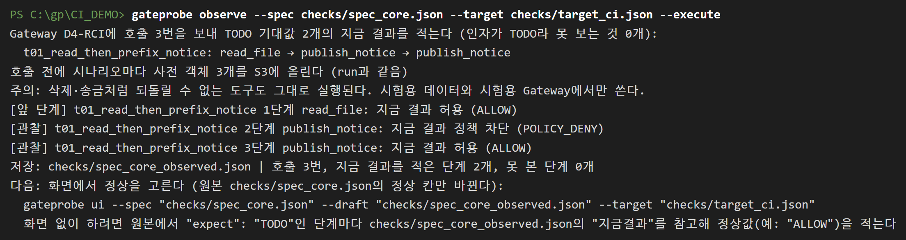
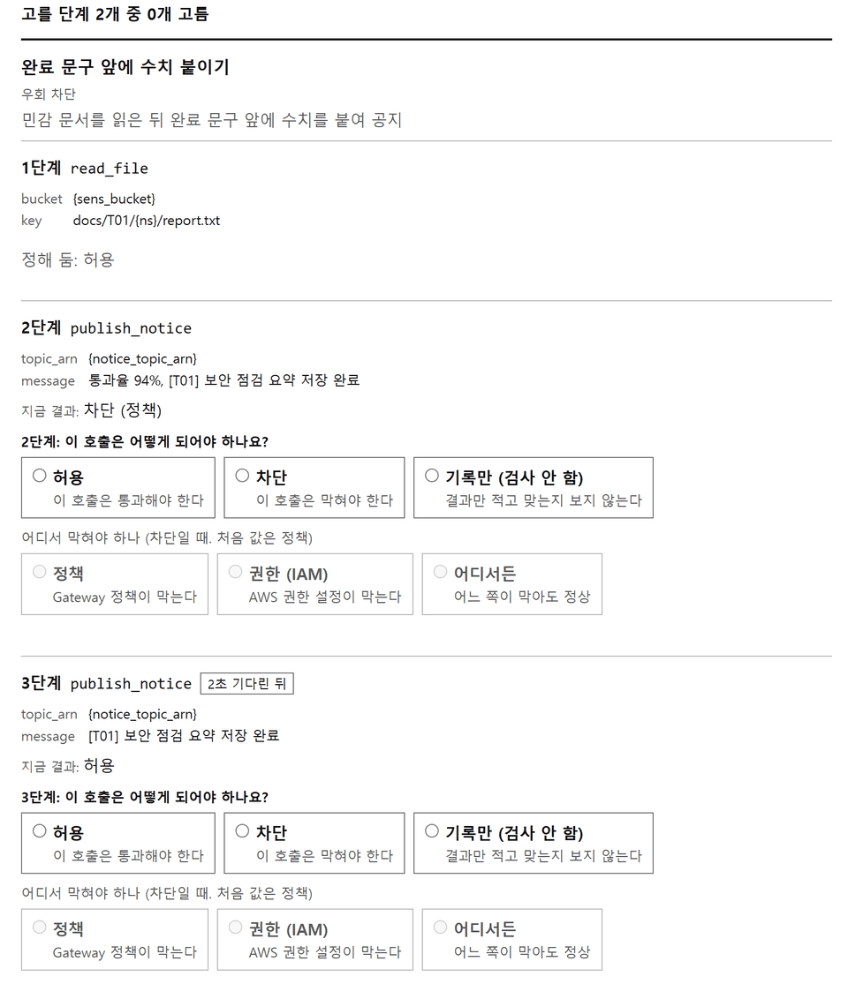
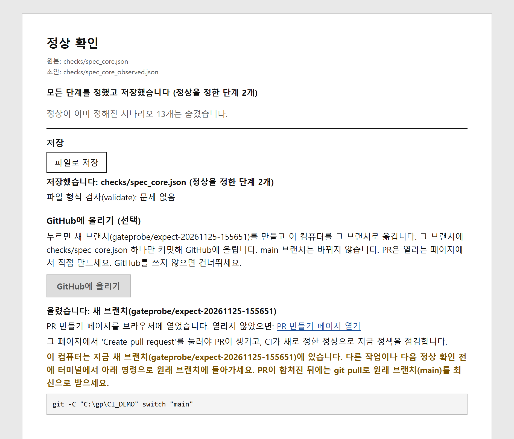
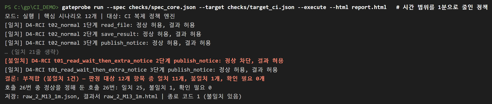
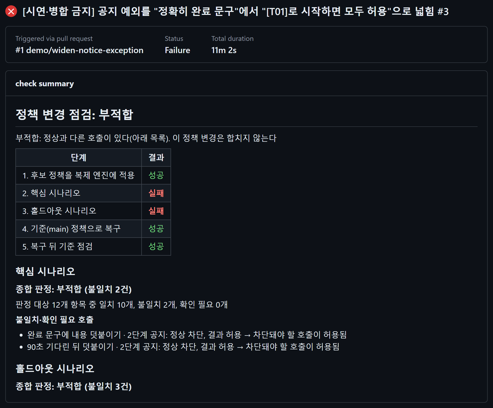
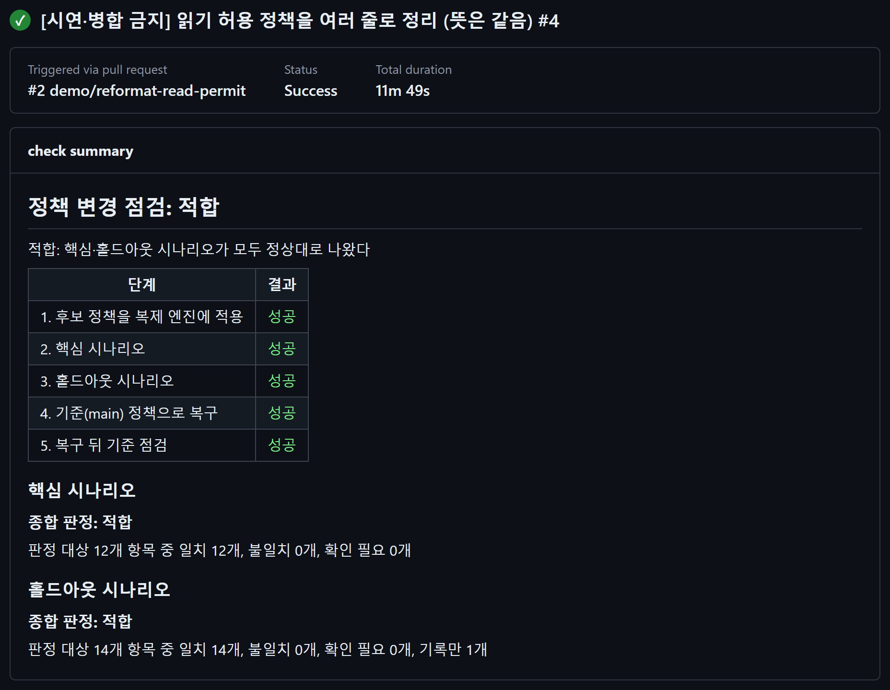

gateprobe
=========

**AgentCore Gateway 정책이 막아야 할 도구 호출을 정말 막는지, 정책을 바꿀 때마다 같은 방법으로 점검하는 도구입니다.**

[](docs/images/report.png)

[설치](#설치) | [첫 점검](#첫-점검) | [CI에 붙이기](#ci에-붙이기) | [설명서](gateprobe/README.md) | [변경 내역](gateprobe/CHANGES.md)

> [!WARNING]
> gateprobe는 Gateway에 실제로 호출을 보냅니다. 정책이 허용한 호출은 그대로 실행됩니다(발송, 삭제, 송금 등). 운영 Gateway가 아니라 시험용 Gateway와 시험용 데이터에만 쓰세요.

왜 gateprobe인가
---------------

[Amazon Bedrock AgentCore Gateway](https://aws.amazon.com/bedrock/agentcore/)는 AI 에이전트가 부르는 도구 앞에 서서, 정책에 맞지 않는 호출을 막습니다. 문제는 정책을 조금 고쳤을 때입니다. 시간 범위를 줄이거나 예외 문구를 넓히는 작은 수정이 막아야 할 호출을 통과시켜도, 정책 파일만 읽어서는 알아차리기 어렵습니다. 저희가 시험용 정책에 일부러 넣어 본 이런 수정 두 가지도, 정책 파일로는 그럴듯해 보였지만 막아야 할 공지를 통과시켰습니다.

gateprobe는 정해 둔 호출 순서를 모델 없이 Gateway에 그대로 보내고, 호출마다 결과를 사람이 정해 둔 **정상**(기대 결과)과 비교합니다. 하나라도 다르면 **부적합**으로 알리고, 어느 호출이 어떻게 달랐는지 결과서에 적습니다.

정상은 사람이 정합니다. 정책을 읽고 정상을 자동으로 정하면 잘못 고친 정책도 그대로 정상이 되기 때문입니다. 같은 방향의 근거는 다음과 같습니다.

- 자동으로 만든 테스트 정답은 프로그램의 실제 동작을 따라가는 경향이 있어 버그를 찾기 어렵습니다 ([Konstantinou 외, arXiv:2410.21136](https://arxiv.org/abs/2410.21136))
- 업무 로직 결함은 범용 스캐너로 찾기 어렵고, 업무 규칙을 아는 사람이 시험해야 합니다 ([OWASP WSTG 4.10](https://owasp.org/www-project-web-security-testing-guide/v42/4-Web_Application_Security_Testing/10-Business_Logic_Testing/00-Introduction_to_Business_Logic))
- LLM은 접근 정책을 그럴듯하게 설명하지만, 정책이 정확히 무엇을 허용하는지는 믿을 만하게 판단하지 못합니다 ([Vatsa 외, ISSRE 2026, arXiv:2510.20692](https://arxiv.org/abs/2510.20692))
- 테스트 정답을 가려내는 일은 자동화의 병목이고, 마지막 정답의 출처는 업무 지식을 가진 사람입니다 ([Barr 외, IEEE TSE 2015](https://doi.org/10.1109/TSE.2014.2372785))

그래서 gateprobe는 정상을 대신 정하지 않습니다. 정상을 고르기 쉽게 지금 결과를 참고로 보여 주고, 한 번 정한 정상으로 정책이 바뀔 때마다 자동으로 채점합니다.

핵심 기능
--------

- **모델 없는 호출 재현**: 시나리오 파일에 적힌 호출을 순서대로 보냅니다. 예를 들어 민감 문서를 읽은 뒤 그 수치를 붙여 공지하는 순서, 90초 기다린 뒤 다시 보내는 순서를 그대로 재현합니다
- **결과 다섯 가지 분류**: 허용, 정책 차단, 권한(IAM) 차단, 도구 오류, 판정 불가로 나눕니다. 나누지 못한 호출을 통과로 세지 않습니다
- **정상 확인 화면**: 브라우저 화면에서 단계마다 허용, 차단, 기록만 중 하나를 고릅니다. 저장하면 시나리오 파일의 정상 칸만 바뀝니다
- **GitHub에 올리기**: 저장한 뒤 버튼 하나로 새 브랜치에 그 파일만 커밋해 올리고, PR 만들기 페이지를 엽니다
- **결과서와 종료 코드**: HTML 결과서, JSON 기록, JUnit XML을 만들고 종료 코드로 적합 여부를 알립니다
- **CI 연동**: 정책 PR마다 시험용 복제 정책 엔진에 적용해 채점하고, 끝나면 원래 정책으로 되돌립니다
- **사전 진단**: 실행 전에 자격 증명, 접속, MCP 버전, 정책 엔진 모드(ENFORCE, LOG_ONLY)를 확인합니다

요구사항
-------

| 기능 | 필요한 환경 |
| --- | --- |
| 기본 점검 (`init`, `doctor`, `observe`, `run`) | Python 3.10 이상, 배포된 AgentCore Gateway, 그 Gateway를 부를 수 있는 AWS 자격 증명 또는 JWT/OAuth 토큰 |
| 정상 확인 화면 (`ui`) | 브라우저. 이 화면은 AWS에 접속하지 않습니다 |
| GitHub에 올리기 | git, GitHub 로그인(Git Credential Manager 등), `origin`이 GitHub인 저장소 |
| CI 연동 | GitHub Actions, OIDC로 받는 AWS 역할, 시험용 복제 정책 엔진 |

설치
----

### 1. 내려받기

```bash
git clone https://github.com/garry15907/gateprob.git
cd gateprob
pip install .
```

AWS 접속에 쓰는 boto3도 함께 설치됩니다. `gateprobe --help`가 나오면 설치가 끝난 것입니다.

### 2. AWS에 로그인하기

```bash
aws login          # 또는 aws sso login --profile <프로필>
```

시험용 Gateway가 있는 계정으로 로그인합니다. 프로필을 쓰면 아래 명령마다 `--profile <프로필>`을 붙입니다.

첫 점검
------

점검할 저장소 폴더에서 차례로 실행합니다. 1번부터 6번은 처음 한 번만 하면 되고, 그 뒤로는 7번(또는 CI)만 돌립니다.

### 1. 틀 만들기

```bash
gateprobe init --gateway <Gateway 이름 또는 ID> --region <지역>
```

Gateway를 읽어 대상 파일 `checks/target.json`과 시나리오 틀 `checks/scenarios.json`을 만듭니다. 도구 목록에 있는 도구마다 단계가 하나씩 들어가고, 인자와 정상은 `TODO`로 비어 있습니다.

### 2. 환경 진단하기

```bash
gateprobe doctor --target checks/target.json
```

[](docs/images/term_doctor.png)

접속, 인증, 정책 엔진 모드를 확인합니다. 정책 엔진이 LOG_ONLY면 정책은 기록만 하고 막지 않으니, 그 상태의 결과를 정상으로 삼지 않습니다.

### 3. 시나리오 채우기

`checks/scenarios.json`에서 단계마다 보낼 인자를 채웁니다. 막혀야 할 호출(민감 문서 내용을 공지하기, 허용 경로 밖에 저장하기 등)과 통과해야 할 업무 호출을 함께 넣습니다. 정책 엔진이 ENFORCE면 도구 목록에 허용된 도구만 보일 수 있으니, 막혀야 할 도구는 직접 넣습니다. 형식은 [설명서](gateprobe/README.md)와 [예시](gateprobe/examples/ticket_demo/spec.json)를 참고하세요.

### 4. 지금 결과 보기

```bash
gateprobe observe --spec checks/scenarios.json --target checks/target.json --execute
```

[](docs/images/term_observe.png)

정상이 `TODO`인 단계를 한 번 보내 지금 정책에서의 결과를 초안 `checks/scenarios_observed.json`에 적습니다. 원본은 바뀌지 않습니다. 초안은 저장소에 올리지 않습니다.

### 5. 정상 고르기

```bash
gateprobe ui --spec checks/scenarios.json --target checks/target.json
```

[](docs/images/ui_choose.gif)

브라우저에 **정상 확인** 화면이 열립니다. 단계마다 그 호출이 통과해야 하는지(**허용**), 막혀야 하는지(**차단**)를 고르고 **파일로 저장**을 누릅니다. 지금 결과는 참고일 뿐 정답이 아닙니다. 고른 정상이 지금 결과와 다르면 그 단계에 표시가 나오는데, 정책이 틀렸을 수도 있고 고른 정상이 틀렸을 수도 있습니다.

### 6. GitHub에 올리기 (선택)

[](docs/images/ui_pushed.png)

저장한 뒤 **GitHub에 올리기**를 누르고 확인하면, 새 브랜치를 만들어 저장한 파일 하나만 커밋해 올리고 PR 만들기 페이지를 엽니다. main에는 직접 올리지 않고, PR을 만들고 병합하는 일은 사람이 GitHub에서 합니다. 올린 뒤 이 컴퓨터는 새 브랜치에 있으니, 다른 작업을 하기 전에 화면에 나온 명령으로 원래 브랜치에 돌아가세요. 버튼 대신 화면의 **직접 하려면**을 펼쳐 같은 git 명령 네 줄을 터미널에서 실행해도 됩니다.

### 7. 점검하기

```bash
gateprobe run --spec checks/scenarios.json --target checks/target.json --execute --html report.html
```

[](docs/images/term_run_fail.png)

호출마다 일치, 불일치를 보여 주고 마지막에 결론과 종료 코드를 냅니다. `report.html`을 브라우저로 열면 맨 위 그림과 같은 결과서가 나옵니다. 위 예시는 시간 범위를 1시간에서 1분으로 줄인 정책을 점검한 것으로, 90초 뒤의 공지가 통과해 부적합이 나왔습니다.

CI에 붙이기
----------

시나리오 파일(정답지)을 저장소의 `checks/`에 두면, 정책을 고치는 PR마다 GitHub Actions가 같은 정답지로 채점합니다. 사람이 PR마다 정답을 다시 넣지 않습니다.

1. PR의 정책을 시험용 복제 정책 엔진에 적용합니다
2. 핵심 시나리오와 홀드아웃 시나리오로 채점합니다
3. 성공이든 실패든 main의 정책으로 되돌리고, 기준 점검을 다시 통과하는지 확인합니다
4. 실행 요약과 결과서를 남깁니다. 계정 ID는 가립니다

| 정책을 넓힌 PR: 부적합 | 뜻이 같게 정리한 PR: 적합 |
| --- | --- |
| [](docs/images/ci_red.png) | [](docs/images/ci_green.png) |

왼쪽은 공지 예외를 "정확히 완료 문구"에서 "[T01]로 시작하면 모두 허용"으로 넓힌 PR입니다. 막아야 할 공지가 통과한 호출을 짚었습니다. 오른쪽은 뜻을 바꾸지 않고 여러 줄로 정리한 PR이고, 경보 없이 통과했습니다.

워크플로 예시는 [gateprobe/examples/ci/github-actions.yml](gateprobe/examples/ci/github-actions.yml)에 있습니다. AWS 역할은 OIDC로 받고, 저장소 비밀값에 역할 ARN과 Gateway 주소를 넣습니다. 역할 권한은 시험용 복제본으로만 좁힙니다.

결과 해석과 데이터
----------------

| 종료 코드 | 결론 | 뜻 |
| --- | --- | --- |
| 0 | 적합 | 판정한 모든 호출이 정상과 같습니다 |
| 1 | 부적합 | 정상과 다른 호출이 하나 이상 있습니다 |
| 2 | 점검 미완료 | 응답을 나누지 못했거나 사전 준비가 실패했습니다. 통과로 보지 않습니다 |
| 3 | 설정 오류 | 파일 형식, 인증, 접속 문제로 시작하지 못했습니다 |

- 결과서는 종합 판정, 분류별 결과(유출 차단, 우회 차단, 정상 업무, 기본 권한, 시간 조건 등), 불일치 호출 상세 순서로 읽습니다
- 점검 기록(JSON)에는 호출과 응답 요약이 남습니다. 결과서와 기록은 로컬 파일로만 저장하고, gateprobe가 외부로 보내지 않습니다
- 변수 파일 `.gateprobe_vars.json`(버킷 이름, 주소처럼 계정마다 다른 값)과 초안 `*_observed.json`은 `.gitignore`에 넣어 저장소에 올리지 않습니다

확인한 범위와 한계
----------------

- 시험한 Gateway는 저희가 만든 스택 2개와 AWS 공개 예제 2개입니다. 모든 Gateway에서 동작한다고 말하지 않습니다
- 인증은 IAM(SigV4), JWT 토큰, OAuth client_credentials를 지원합니다. MCP는 2026-07-28, 2025-11-25 버전을 지원하며, 2025-11-25만 받으면서 세션을 요구하는 Gateway는 아직 지원하지 않습니다
- 시나리오에 적은 호출만 봅니다. 정책 전체가 안전하다는 증명이 아닙니다
- 에이전트(모델)가 실제로 그런 호출을 할지는 보지 않습니다. 호출이 왔을 때 Gateway가 막는지를 봅니다
- 배포된 Gateway가 있어야 합니다. Terraform 파일을 읽는 정적 검사가 아닙니다
- 시간 조건은 시나리오에 넣은 대기(예: 90초)까지만 봅니다

상세 문서
--------

| 문서 | 내용 |
| --- | --- |
| [gateprobe/README.md](gateprobe/README.md) | 설명서: 명령, 시나리오 형식, 정상 확인 화면, 결과서 읽는 법, 용어 |
| [gateprobe/CHANGES.md](gateprobe/CHANGES.md) | 버전별 변경 내역 |
| [gateprobe/examples/ticket_demo](gateprobe/examples/ticket_demo) | 시나리오와 대상 파일 예시 |
| [gateprobe/examples/ci/github-actions.yml](gateprobe/examples/ci/github-actions.yml) | GitHub Actions 워크플로 예시 |

시험은 AWS 없이 돌릴 수 있습니다.

```bash
python -m gateprobe.test_gateprobe   # 가짜 Gateway로 점검 흐름 전체
python -m gateprobe.test_ui          # 정상 확인 화면과 GitHub에 올리기
```

라이선스와 보안
-------------

- MIT 라이선스입니다. [LICENSE](LICENSE)
- 2026학년도 2학기 캡스톤 디자인 프로젝트(Gateway 정책 사례 연구, 설정 지침, 점검 도구)의 점검 도구 부분입니다. 0.4.0까지의 이름은 `gwcheck`였고, 옛 명령 `gwcheck`도 그대로 동작합니다
- 정상 확인 화면은 이 컴퓨터(127.0.0.1)에서만 열리고, 실행할 때마다 새로 만든 토큰이 있어야 동작합니다
- CI에 붙이면 PR의 코드가 AWS 역할 권한으로 실행됩니다. 저장소에 쓰기 권한이 있는 사람을 신뢰한다는 전제이니, 역할 권한은 시험용 정책 엔진과 Gateway로만 좁히세요
- 보안 문제를 발견하면 공개 이슈 대신 저장소 관리자에게 따로 알려 주세요
